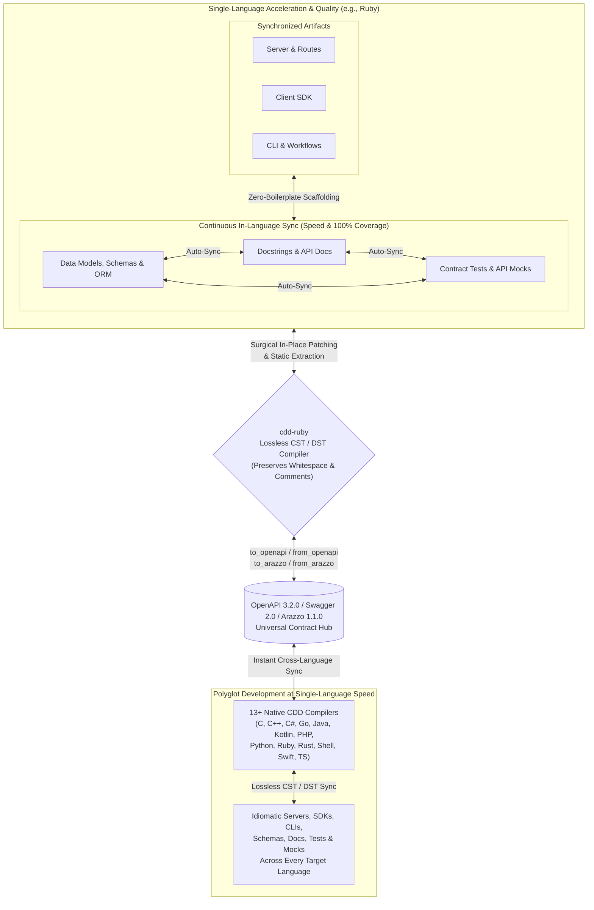

cdd-ruby: Ruby ⇄ OpenAPI
========================

[](https://opensource.org/licenses/Apache-2.0)
[](https://offscale.io/wasm_web_demo)
[](https://github.com/SamuelMarks/cdd-ruby/actions)
[](#)
[](#)

**cdd-ruby** compiles **[OpenAPI](https://spec.openapis.org/oas/latest.html) / [Swagger](https://spec.openapis.org/oas/v2.0.html) / [Arazzo](https://spec.openapis.org/arazzo/latest.html)** to and from **Ruby** (servers, client SDKs, CLIs, database schemas, tests, mocks, and docs), updating your existing code in-place without overwriting your edits.

**Compiler Driven Development (CDD)** is a software engineering methodology that uses a suite of standalone, lossless compilers to synchronize API specifications, server implementations, client SDKs, command-line tooling, workflow orchestrators, tests, and documentation.

Unlike traditional code generators that treat outputs as disposable or read-only, Compiler Driven Development provides a **complete, standalone compiler** (exposed as both a CLI and a programmatic SDK) written natively in each supported language. Where conventional compilers rely solely on an Abstract Syntax Tree (AST) that discards formatting and comments, CDD compilers operate on a **Concrete Syntax Tree (CST)** or **Decorated Syntax Tree (DST)**. This guarantees **lossless conversion**—preserving exact whitespace, indentation, inline comments, block comments, and docstrings—allowing true bidirectional synchronization between hand-edited `Ruby` source code and [OpenAPI 3.2.0](https://spec.openapis.org/oas/v3.2.0.html), [Swagger 2.0](https://spec.openapis.org/oas/v2.0.html), and [Arazzo 1.1.0](https://spec.openapis.org/arazzo/v1.1.0.html) specifications.

---

## Why Compiler Driven Development?

By replacing one-way templates and manual boilerplate with lossless CST/DST compilers, Compiler Driven Development transforms the engineering lifecycle across four dimensions:

- **Development Speed**: Eliminate manual boilerplate across servers, client SDKs, CLIs, database models, workflow runners, and mock servers. Start from an [OpenAPI](https://spec.openapis.org/oas/latest.html) or [Arazzo](https://spec.openapis.org/arazzo/latest.html) specification to scaffold an entire installable project (complete with package manifests and CI workflows), or write code first in `Ruby` and extract the specification automatically. When requirements change, update whichever representation is most convenient and synchronize the rest immediately.
- **Development Consistency**: Every data model, route handler, CLI flag, ORM entity, workflow step, and API contract is derived from and validated against the same semantic representation. Architectural drift between backend routes, frontend clients, and published specifications becomes structurally impossible.
- **Development Quality**: Keeping tests and documentation in lockstep with implementation code is automated rather than an afterthought. Because the compiler parses and emits docstrings, type signatures, API mocks, and contract test suites alongside your business logic, maintaining **100% documentation coverage and 100% test coverage** becomes a natural byproduct of compilation rather than a manual chore.
- **Polyglot Development**: Seamlessly bridge **13+ programming languages** (C, C++, C#, Go, Java, Kotlin, PHP, Python, Ruby, Rust, POSIX Shell, Swift, and TypeScript) to and from [OpenAPI](https://spec.openapis.org/oas/latest.html) and [Arazzo](https://spec.openapis.org/arazzo/latest.html) specifications. Any codebase in any supported language can be reverse-compiled into OpenAPI/Arazzo and immediately compiled forward into idiomatic, human-editable code across every other language in the suite. And being an open-source methodology—rather than a proprietary trade secret—new languages can be added by implementing new compilers that follow the CDD approach (see [cdd-spec-conformance](https://github.com/SamuelMarks/cdd-spec-conformance) for tooling to facilitate).

---

## The Standalone Compiler Architecture and Lossless Conversion

Traditional code generation tools rely on destructive templating: if you regenerate your project from an updated specification, your custom implementation logic, formatting, and comments are overwritten.

Each Compiler Driven Development toolchain is written natively in its target language, compiles both to native binaries and to **WebAssembly (WASM/WASI)**, and implements a full lexer, parser, semantic differ, and code emitter backed by Concrete Syntax Tree (CST) and Decorated Syntax Tree (DST) representations:

- **Beyond AST to CST/DST**: A standard Abstract Syntax Tree (AST) captures program semantics while stripping away "trivia" (whitespace, blank lines, and comments). By pairing structural AST semantics with a Concrete Syntax Tree (CST) or Decorated Syntax Tree (DST) that attaches trivia and structured documentation directly to syntax nodes, the compiler preserves 100% of your source formatting and comments.
- **Zero-Destruction Guarantee**: Every part of the generated codebase is designed to be edited by humans. You can open generated routing files, data models, database entities, workflow runners, tests, and CLI commands, format them to your preferences, add inline comments, and inject custom business logic.
- **When your specification changes**: The CDD compiler parses your existing source files into a CST/DST, computes a semantic diff against the updated [OpenAPI](https://spec.openapis.org/oas/latest.html) or [Arazzo](https://spec.openapis.org/arazzo/latest.html) specification, and surgically patches in new endpoints, workflows, parameters, or fields without disturbing your custom logic, comments, or whitespace.
- **When your codebase changes**: The compiler statically analyzes your updated source code, routes, workflows, tests, and docstrings—without unsafe dynamic code execution or reflection—to extract a 100% compliant, authoritative [OpenAPI](https://spec.openapis.org/oas/latest.html) or [Arazzo](https://spec.openapis.org/arazzo/latest.html) specification.

---

## The Bidirectional Synchronization Loop



The Compiler Driven Development lifecycle delivers compounding returns in both single-language and polyglot environments:
1. **Single-Language Speed**: Edit whichever artifact is most convenient—models/schemas, route handlers, docstrings, or tests—and let `cdd-ruby` surgically synchronize the rest in-place without overwriting your custom logic, comments, or whitespace.
2. **Single-Language Quality**: Because schemas, documentation, contract tests, and mocks are continuously cross-compiled rather than manually maintained, **100% doc coverage and 100% test coverage** are enforced automatically on every sync.
3. **Polyglot Development at Single-Language Speed**: Extracting an authoritative [OpenAPI](https://spec.openapis.org/oas/latest.html) or [Arazzo](https://spec.openapis.org/arazzo/latest.html) contract from one language immediately drives lossless forward-compilation across all 13+ supported languages—making multi-language SDK, CLI, and service maintenance just as fast as working in a single codebase.

---

## Core Capabilities Shared Across All CDD Compilers

Every `cdd-*` repository in the suite implements the same foundational feature set:

- **Bidirectional OpenAPI 3.2.0 & Swagger 2.0 Compilation**:
  - `from_openapi`: Generate idiomatic `Ruby` Client SDKs (`to_sdk`), Client CLIs (`to_sdk_cli`), and Server stubs/routers (`to_server`) from a single specification (`-i`) or a batch directory of specifications (`--input-dir`). Automatically upgrades legacy Swagger 2.0 and OpenAPI 3.0/3.1 specifications to OpenAPI 3.2.0.
  - `to_openapi`: Statically parse existing `Ruby` source files or directories to extract a compliant OpenAPI 3.2.0 specification.
- **Bidirectional Arazzo 1.1.0 Workflow Orchestration**:
  - `from_arazzo`: Compile multi-step [Arazzo 1.1.0](https://spec.openapis.org/arazzo/v1.1.0.html) workflow specifications (including runtime expressions, step DAGs, criterion evaluations, and failure/success actions) into `Ruby` SDK workflow orchestrators (`to_sdk`), CLI workflow runners (`to_sdk_cli`), and Server/E2E workflow test suites (`to_server`).
  - `to_arazzo`: Reverse-parse `Ruby` workflow orchestrators, CLI scripts, or E2E test suites back into an authoritative Arazzo 1.1.0 document.
- **In-Place Codebase Synchronization (`sync`)**:
  - Synchronize data models, ORM schemas, route handlers, docstrings, contract tests, mocks, and specifications in-place using lossless CST/DST patching.
- **Documentation Code-Snippet Generation (`to_docs_json`)**:
  - Emit a structured JSON documentation payload containing idiomatic `Ruby` request/workflow code snippets for every operation in an OpenAPI specification (with `--no-imports` and `--no-wrapping` options for embedding in documentation portals).
- **Composable Contract Tests, Mocks, CI, and Package Scaffolding**:
  - By default, `from_openapi` and `from_arazzo` scaffold complete, installable `Ruby` packages and `.github/workflows/ci.yml` pipelines (configurable via `--no-installable-package` and `--no-github-actions`), and generate contract test suites and API mocks/fakes via `--tests`.
- **Model Context Protocol (`mcp`) & JSON-RPC (`serve_json_rpc`)**:
  - Run `cdd-ruby mcp` to expose the compiler over stdio as an [MCP](https://modelcontextprotocol.io/) server for AI assistants and IDEs, or pass `--mcp` during generation to emit MCP tool/resource adapters directly inside generated SDKs and servers.
  - Run `cdd-ruby serve_json_rpc` to expose the compiler's full API over JSON-RPC 2.0 (`--port`, `--listen`).
- **Native CLI, Programmatic SDK, and WebAssembly (WASM/WASI)**:
  - Use `cdd-ruby` from the command line, import its programmatic SDK directly into `Ruby` applications, or run it in the browser and WASI runtimes via its WebAssembly build (see [WASM.md](WASM.md)).

---

## The Global Polyglot Ecosystem

Every supported language operates on the same core Compiler Driven Development principles and is powered by a dedicated, native compiler tailored to that language's syntax tree, idioms, and package manager.

All implementations expose a standardized command-line interface (`cdd-ruby <subcommand>`) and programmatic SDK.

| Repository | Language | Targets (`to_sdk`; `to_sdk_cli`; `to_server`) | Special Features Beyond Common Subset | Standards | CI Status |
|---|---|---|---|---|---|
| [`cdd-c`](https://github.com/SamuelMarks/cdd-c) | C (C89) | Client; Client CLI; Server | 42-Language FFI Generator (`bind`); GNU-to-C89 AST Lowering; Safe CRT & Memory Security Auditor; `c-orm` Migrations | [Arazzo 1.1.0](https://spec.openapis.org/arazzo/v1.1.0.html); [Swagger 2.0](https://spec.openapis.org/oas/v2.0.html); [OpenAPI 3.2.0](https://spec.openapis.org/oas/v3.2.0.html); [MCP](https://modelcontextprotocol.io/) | [](https://github.com/SamuelMarks/cdd-c/actions/workflows/ci.yml) |
| [`cdd-cpp`](https://github.com/SamuelMarks/cdd-cpp) | C++ | Client; Client CLI; Server | [Google Discovery](https://developers.google.com/discovery) (`from_google_discovery`); PostgreSQL `libpq` ORM & Faker Support | [Google Discovery](https://developers.google.com/discovery); [Arazzo 1.1.0](https://spec.openapis.org/arazzo/v1.1.0.html); [Swagger 2.0](https://spec.openapis.org/oas/v2.0.html); [OpenAPI 3.2.0](https://spec.openapis.org/oas/v3.2.0.html); [MCP](https://modelcontextprotocol.io/) | [](https://github.com/SamuelMarks/cdd-cpp/actions/workflows/ci.yml) |
| [`cdd-csharp`](https://github.com/SamuelMarks/cdd-csharp) | C# | Client; Client CLI; Server | CLR & Roslyn CST/DST Trivia-Preserving Sync; Entity Framework & Minimal API Targets | [Arazzo 1.1.0](https://spec.openapis.org/arazzo/v1.1.0.html); [Swagger 2.0](https://spec.openapis.org/oas/v2.0.html); [OpenAPI 3.2.0](https://spec.openapis.org/oas/v3.2.0.html); [MCP](https://modelcontextprotocol.io/) | [](https://github.com/SamuelMarks/cdd-csharp/actions/workflows/ci.yml) |
| [`cdd-go`](https://github.com/SamuelMarks/cdd-go) | Go | Client; Client CLI; Server | Go `dst`/`ast` Surgical Patching; Multi-Source Truth Sync (`code` ⇄ `openapi`) | [Arazzo 1.1.0](https://spec.openapis.org/arazzo/v1.1.0.html); [Swagger 2.0](https://spec.openapis.org/oas/v2.0.html); [OpenAPI 3.2.0](https://spec.openapis.org/oas/v3.2.0.html); [MCP](https://modelcontextprotocol.io/) | [](https://github.com/SamuelMarks/cdd-go/actions/workflows/ci.yml) |
| [`cdd-java`](https://github.com/SamuelMarks/cdd-java) | Java | Client; Client CLI; Server | JavaParser CST Lexical Preservation; WASI JSON-RPC Mode; In-Memory Compiler Pipeline | [Arazzo 1.1.0](https://spec.openapis.org/arazzo/v1.1.0.html); [Swagger 2.0](https://spec.openapis.org/oas/v2.0.html); [OpenAPI 3.2.0](https://spec.openapis.org/oas/v3.2.0.html); [MCP](https://modelcontextprotocol.io/) | [](https://github.com/SamuelMarks/cdd-java/actions/workflows/ci.yml) |
| [`cdd-kotlin`](https://github.com/offscale/cdd-kotlin) | Kotlin (Ktor Multiplatform) | Client; Client CLI; Server | Multiplatform Auto-Admin UI; Ephemeral & Seeded Mock Server Modes; Webhook Triggers | [Arazzo 1.1.0](https://spec.openapis.org/arazzo/v1.1.0.html); [Swagger 2.0](https://spec.openapis.org/oas/v2.0.html); [OpenAPI 3.2.0](https://spec.openapis.org/oas/v3.2.0.html); [MCP](https://modelcontextprotocol.io/) | [](https://github.com/offscale/cdd-kotlin/actions/workflows/ci.yml) |
| [`cdd-php`](https://github.com/SamuelMarks/cdd-php) | PHP | Client; Client CLI; Server | Multi-Tiered DAO (`StubDao` / `ConcreteDao`); Ephemeral & Faker-Seeded SQLite Server Modes | [Arazzo 1.1.0](https://spec.openapis.org/arazzo/v1.1.0.html); [Swagger 2.0](https://spec.openapis.org/oas/v2.0.html); [OpenAPI 3.2.0](https://spec.openapis.org/oas/v3.2.0.html); [MCP](https://modelcontextprotocol.io/) | [](https://github.com/SamuelMarks/cdd-php/actions/workflows/ci.yml) |
| [`cdd-python`](https://github.com/offscale/cdd-python) | Python | N/A (server building blocks) | CLI ⇄ SQLAlchemy ⇄ Pydantic ⇄ Docs ⇄ JSON Schema | N/A | [](https://github.com/offscale/cdd-python/actions) |
| [`cdd-python-all`](https://github.com/offscale/cdd-python-all) | Python | Client; Client CLI; Server | `LibCST` Lossless Sync; Multi-Truth Sync (`class`, `sqlalchemy`, `function`, `openapi`); FastAPI + SQLAlchemy | [Arazzo 1.1.0](https://spec.openapis.org/arazzo/v1.1.0.html); [Swagger 2.0](https://spec.openapis.org/oas/v2.0.html); [OpenAPI 3.2.0](https://spec.openapis.org/oas/v3.2.0.html); [MCP](https://modelcontextprotocol.io/) | [](https://github.com/offscale/cdd-python-all/actions/workflows/ci.yml) |
| [`cdd-ruby`](https://github.com/SamuelMarks/cdd-ruby) | Ruby | Client; Client CLI; Server | ActiveRecord Sync (`class`, `activerecord`, `function`); Ephemeral & Seeded Server Generation | [Arazzo 1.1.0](https://spec.openapis.org/arazzo/v1.1.0.html); [Swagger 2.0](https://spec.openapis.org/oas/v2.0.html); [OpenAPI 3.2.0](https://spec.openapis.org/oas/v3.2.0.html); [MCP](https://modelcontextprotocol.io/) | [](https://github.com/SamuelMarks/cdd-ruby/actions/workflows/ci.yml) |
| [`cdd-rust`](https://github.com/SamuelMarks/cdd-rust) | Rust | Client; Client CLI; Server | Actix-Web, Axum & Reqwest Targets; Diesel Schema Sync; Standalone `schema-gen`, `scaffold` & `test-gen` | [Arazzo 1.1.0](https://spec.openapis.org/arazzo/v1.1.0.html); [Swagger 2.0](https://spec.openapis.org/oas/v2.0.html); [OpenAPI 3.2.0](https://spec.openapis.org/oas/v3.2.0.html); [MCP](https://modelcontextprotocol.io/) | [](https://github.com/SamuelMarks/cdd-rust/actions/workflows/ci.yml) |
| [`cdd-sh`](https://github.com/SamuelMarks/cdd-sh) | Shell (`/bin/sh`) | Client; Client CLI; Server | Zero-Dependency Embedded `sh`/`jq`/`awk` Cross-Platform Binary; Direct AST `parse` & `emit` Subcommands | [Arazzo 1.1.0](https://spec.openapis.org/arazzo/v1.1.0.html); [Swagger 2.0](https://spec.openapis.org/oas/v2.0.html); [OpenAPI 3.2.0](https://spec.openapis.org/oas/v3.2.0.html); [MCP](https://modelcontextprotocol.io/) | [](https://github.com/SamuelMarks/cdd-sh/actions/workflows/ci.yml) |
| [`cdd-swift`](https://github.com/SamuelMarks/cdd-swift) | Swift | Client; Client CLI; Server | `SwiftSyntax` Lossless Merging (`merge_swift`); Vapor + Fluent ORM Scaffolding; `sync_arazzo` | [Arazzo 1.1.0](https://spec.openapis.org/arazzo/v1.1.0.html); [Swagger 2.0](https://spec.openapis.org/oas/v2.0.html); [OpenAPI 3.2.0](https://spec.openapis.org/oas/v3.2.0.html); [MCP](https://modelcontextprotocol.io/) | [](https://github.com/SamuelMarks/cdd-swift/actions/workflows/ci.yml) |
| [`cdd-ts`](https://github.com/offscale/cdd-ts) | TypeScript | Client; Client CLI; Server | Auto-Admin UI; Angular, React, Vue, Vanilla; Fetch, Axios, Node; Express, Bun, Deno; TypeORM Sync | [Arazzo 1.1.0](https://spec.openapis.org/arazzo/v1.1.0.html); [Swagger 2.0](https://spec.openapis.org/oas/v2.0.html); [OpenAPI 3.2.0](https://spec.openapis.org/oas/v3.2.0.html); [MCP](https://modelcontextprotocol.io/) | [](https://github.com/offscale/cdd-ts/actions/workflows/ci.yml) |

---

## Programmatic SDK & CLI Quickstart

Every `cdd-*` toolchain can be invoked either as a standalone CLI binary or imported as a native `Ruby` library.

### Minimal CLI Usage

```sh
# Print help and version
cdd-ruby --help
cdd-ruby --version

# Generate a Ruby Client SDK, Client CLI, or Server from an OpenAPI spec
cdd-ruby from_openapi to_sdk -i spec.json -o ./sdk --tests
cdd-ruby from_openapi to_sdk_cli -i spec.json -o ./cli --tests
cdd-ruby from_openapi to_server -i spec.json -o ./server --tests

# Extract an OpenAPI 3.2.0 spec from existing Ruby source code
cdd-ruby to_openapi -i ./src -o openapi.json

# Generate and extract Arazzo 1.1.0 multi-step workflows
cdd-ruby from_arazzo to_sdk -i workflow.arazzo.json -o ./workflows --tests
cdd-ruby from_arazzo to_sdk_cli -i workflow.arazzo.json -o ./workflow-cli --tests
cdd-ruby from_arazzo to_server -i workflow.arazzo.json -o ./workflow-server --tests
cdd-ruby to_arazzo -i ./workflows -o extracted.arazzo.json

# Synchronize codebase models, routes, tests, docs, and OpenAPI in-place
cdd-ruby sync -i ./src -o openapi.json

# Generate documentation-ready Ruby code snippets JSON for an OpenAPI spec
cdd-ruby to_docs_json --no-imports --no-wrapping -i spec.json -o docs.json

# Run as a Model Context Protocol (MCP) server over stdio or JSON-RPC 2.0 server
cdd-ruby mcp
cdd-ruby serve_json_rpc --port 8080 --listen 127.0.0.1
```

### Programmatic SDK Example

```ruby
require 'cdd'

# 1. Parse Ruby source code into an Intermediate Representation (Cdd::IR) and OpenAPI 3.2.0 JSON
ir = Cdd::Parser.parse_to_ir('app.rb')
openapi_json = Cdd::Parser.parse('app.rb')
File.write('spec.json', openapi_json)

# 2. Emit Ruby code (models, Sinatra routes, client functions, tests, mocks) from an OpenAPI spec
ruby_code = Cdd::Emitter.emit('spec.json')

# 3. Generate full project scaffolding via Cdd::CLI and Cdd::Config
config = Cdd::Config.new(
  subcommand: 'to_sdk',
  input: 'spec.json',
  output: './generated_sdk',
  tests: true,
  mcp: true
)
Cdd::CLI.generate_from_openapi(config)

# 4. Synchronize an OpenAPI/Arazzo spec in-place from sibling Ruby source files
Cdd::Sync.sync('spec.json', 'class')

# 5. Generate runnable SDK documentation snippets
docs_json = Cdd::DocsJson::Emitter.emit('spec.json', no_imports: false, no_wrapping: false)
```

### Installation & Development

All `cdd-*` repositories support both native language build tools and a standardized cross-platform `Makefile` / `make.bat` interface (`deps`, `build`, `test`):

```sh
make deps
make build
make test
# or on Windows:
.\make.bat deps
.\make.bat build
.\make.bat test
```

```sh
# Install via RubyGems
gem install cdd-ruby

# Or build, lint, document, and test from source with Bundler
bundle install
gem build cdd-ruby.gemspec
bundle exec rspec
bundle exec rubocop
bundle exec yard stats --list-undoc src/**/*.rb
```

> **Further Documentation**:
> - [**ARCHITECTURE.md**](ARCHITECTURE.md) — Compiler pipeline (Lexer → CST/DST/AST → Semantic Diff → Emitter).
> - [**COMPLIANCE.md**](COMPLIANCE.md) — Swagger 2.0, OpenAPI 3.2.0, Arazzo 1.1.0, and MCP support matrices.
> - [**USAGE.md**](USAGE.md) — Detailed CLI, SDK, ORM, and roundtrip usage guide.
> - [**DEVELOPING.md**](DEVELOPING.md) — Local development, linting, testing, and coverage guide.
> - [**WASM.md**](WASM.md) — WebAssembly / WASI build and browser/Node.js execution instructions.
> - [**PUBLISH.md**](PUBLISH.md) — Package publishing and release workflow.

---

## Universal CLI Toolchain

Once you learn the Compiler Driven Development CLI in one language, you can use the exact same commands, flags, and environment variables across the entire polyglot stack.

### Common Arguments & Environment Variables

| Flag | Short | Environment Variable | Description |
|---|---|---|---|
| `--help` | `-h` | — | Print help information for the CLI or subcommand. |
| `--version` | `-v` / `-V` | — | Print version information. |
| `--input <path>` | `-i` / `-f` | `CDD_INPUT` | Path or URL to the input OpenAPI/Arazzo spec or source file/directory. |
| `--input-dir <dir>` | `-d` | `CDD_INPUT_DIR` | Directory containing multiple OpenAPI/Arazzo specifications for batch generation. |
| `--output <path>` | `-o` | `CDD_OUTPUT` | Destination file or directory path for generated code or extracted specifications. |
| `--tests` | `-t` | `CDD_TESTS` | Generate composable contract/integration tests and API mocks alongside code. |
| `--mcp` | `-m` | `CDD_MCP` | Generate Model Context Protocol (MCP) server and client adapters. |
| `--no-github-actions` | — | `CDD_NO_GITHUB_ACTIONS` | Do not generate `.github/workflows/ci.yml` scaffolding in target output. |
| `--no-installable-package` | — | `CDD_NO_INSTALLABLE_PACKAGE` | Do not generate package manifest/build files in target output. |
| `--no-imports` | — | `CDD_NO_IMPORTS` | (`to_docs_json`) Omit import/include statements from generated documentation snippets. |
| `--no-wrapping` | — | `CDD_NO_WRAPPING` | (`to_docs_json`) Omit boilerplate wrapper functions/classes from documentation snippets. |
| `--port <port>` | `-p` | `CDD_PORT` | (`serve_json_rpc`) TCP port to listen on (default: `8080`). |
| `--listen <addr>` | `-l` | `CDD_LISTEN` | (`serve_json_rpc`) Host/IP address to bind to (default: `127.0.0.1`). |
| `--truth <source>` | `-t` | `CDD_TRUTH` | (`sync`) Designate the single source of truth when synchronizing. |

### Core Subcommands

- **`from_openapi [to_sdk | to_sdk_cli | to_server]`**: Compile an OpenAPI 3.2.0 or Swagger 2.0 specification into an idiomatic `Ruby` Client SDK, Client CLI, or HTTP Server (patching existing files losslessly if the target directory already exists).
- **`to_openapi`**: Statically parse `Ruby` models, routes, client calls, and docstrings into an authoritative OpenAPI 3.2.0 specification.
- **`from_arazzo [to_sdk | to_sdk_cli | to_server]`**: Compile an Arazzo 1.1.0 workflow specification into `Ruby` workflow orchestrators, CLI workflow runners, or server/E2E workflow test suites.
- **`to_arazzo`**: Statically parse `Ruby` workflow code, CLI scripts, or E2E tests into an Arazzo 1.1.0 specification.
- **`sync`**: Bidirectionally synchronize `Ruby` source files (models, ORM entities, routes, functions, tests, and docstrings) with OpenAPI/Arazzo specifications in-place.
- **`to_docs_json`**: Generate documentation-optimized JSON containing `Ruby` code snippets for each operation in an OpenAPI specification.
- **`serve_json_rpc`**: Expose the `cdd-ruby` compiler over a JSON-RPC 2.0 server for IDE integrations and external tooling.
- **`mcp`**: Run the `cdd-ruby` compiler as a Model Context Protocol (MCP) server over standard I/O (`stdio`).

### Verbatim CLI Help Output

#### `cdd-ruby --help`

```text
cdd-ruby CLI
Usage:
  cdd-ruby [subcommand] [options]

Subcommands:
  from_openapi                   Generate code from an OpenAPI specification.
  to_openapi                     Generate an OpenAPI specification from source code.
  from_arazzo                    Generate code from an Arazzo 1.1.0 specification.
  to_arazzo                      Generate an Arazzo 1.1.0 specification from source code.
  to_docs_json                   Generate JSON documentation with code snippets for an OpenAPI specification.
  serve_json_rpc                 Expose CLI interface as a JSON-RPC server.
  mcp                            Run the generator as an MCP server over stdio.
  sync                           Synchronize an OpenAPI specification with source code.

Options:
  -h, --help                     Show this help message
  -v, --version                  Show version information
  -p, --port <port>              Port for the JSON-RPC server
  -l, --listen <address>         Host/IP to listen on for the JSON-RPC server

Examples:
  cdd-ruby serve_json_rpc [--wasi] [-p <port>] [-l <listen>]
  cdd-ruby from_openapi to_sdk_cli -i <spec.json> [-o <target_directory>] [--no-github-actions] [--no-installable-package] [--tests] [--mcp]
  cdd-ruby from_openapi to_sdk -i <spec.json> [-o <target_directory>] [--no-github-actions] [--no-installable-package] [--tests] [--mcp]
  cdd-ruby from_openapi to_server -i <spec.json> [-o <target_directory>]
  cdd-ruby to_openapi -i <path/to/code> [-o <spec.json>]
  cdd-ruby from_arazzo to_sdk -i <arazzo.json> [-o <target_directory>]
  cdd-ruby to_arazzo -i <path/to/code> [-o <arazzo.json>]
  cdd-ruby to_docs_json [--no-imports] [--no-wrapping] -i <spec.json> [-o <docs.json>]
```

#### `cdd-ruby from_openapi --help`

```text
cdd-ruby from_openapi - Generate code from an OpenAPI specification.
Usage:
  cdd-ruby from_openapi [target] [options]

Targets:
  to_sdk_cli    Generate a client SDK and a corresponding CLI.
  to_sdk        Generate a client SDK.
  to_server     Generate server boilerplate, models, and routing logic.

Options:
  -i, --input <spec>             Path to the OpenAPI specification file
  -o, --output <dir>             Destination path for generation (default: current directory)
  -d, --input-dir <dir>          Directory of input specifications
  --arazzo <spec>                Path to an optional Arazzo 1.1.0 workflow specification file
  --no-github-actions            Disable GitHub Actions workflow generation
  --no-installable-package       Disable installable package generation
  --tests                        Generate Minitest test scaffolding
  --mcp                          Include Model Context Protocol support
  --with-ephemeral               Enable ephemeral code generation
  --with-seed                    Include seed data in generation
  -h, --help                     Show this help message
```

#### `cdd-ruby from_openapi to_sdk_cli --help`

```text
cdd-ruby from_openapi to_sdk_cli - Generate a client SDK and a corresponding CLI.
Usage:
  cdd-ruby from_openapi to_sdk_cli -i <spec.json> [-o <target_directory>] [options]

Options:
  -i, --input <spec>             Path to the OpenAPI specification file
  -o, --output <dir>             Destination path for generation (default: current directory)
  -d, --input-dir <dir>          Directory of input specifications
  --arazzo <spec>                Path to an optional Arazzo 1.1.0 workflow specification file
  --no-github-actions            Disable GitHub Actions workflow generation
  --no-installable-package       Disable installable package generation
  --tests                        Generate Minitest test scaffolding
  --mcp                          Include Model Context Protocol support
  --with-ephemeral               Enable ephemeral code generation
  --with-seed                    Include seed data in generation
  -h, --help                     Show this help message
```

#### `cdd-ruby from_openapi to_sdk --help`

```text
cdd-ruby from_openapi to_sdk - Generate a client SDK.
Usage:
  cdd-ruby from_openapi to_sdk -i <spec.json> [-o <target_directory>] [options]

Options:
  -i, --input <spec>             Path to the OpenAPI specification file
  -o, --output <dir>             Destination path for generation (default: current directory)
  -d, --input-dir <dir>          Directory of input specifications
  --arazzo <spec>                Path to an optional Arazzo 1.1.0 workflow specification file
  --no-github-actions            Disable GitHub Actions workflow generation
  --no-installable-package       Disable installable package generation
  --tests                        Generate Minitest test scaffolding
  --mcp                          Include Model Context Protocol support
  --with-ephemeral               Enable ephemeral code generation
  --with-seed                    Include seed data in generation
  -h, --help                     Show this help message
```

#### `cdd-ruby from_openapi to_server --help`

```text
cdd-ruby from_openapi to_server - Generate server boilerplate, models, and routing logic.
Usage:
  cdd-ruby from_openapi to_server -i <spec.json> [-o <target_directory>] [options]

Options:
  -i, --input <spec>             Path to the OpenAPI specification file
  -o, --output <dir>             Destination path for generation (default: current directory)
  -d, --input-dir <dir>          Directory of input specifications
  --arazzo <spec>                Path to an optional Arazzo 1.1.0 workflow specification file
  --no-github-actions            Disable GitHub Actions workflow generation
  --no-installable-package       Disable installable package generation
  --tests                        Generate Minitest test scaffolding
  --mcp                          Include Model Context Protocol support
  --with-ephemeral               Enable ephemeral code generation
  --with-seed                    Include seed data in generation
  -h, --help                     Show this help message
```

#### `cdd-ruby to_openapi --help`

```text
cdd-ruby to_openapi - Generate an OpenAPI specification from source code.
Usage:
  cdd-ruby to_openapi -i <path/to/code> [-o <spec.json>]

Options:
  -i, --input <path>             Path to the source code directory or file to parse
  -o, --output <path>            Destination path for the generated OpenAPI spec (default: spec.json)
  -h, --help                     Show this help message
```

#### `cdd-ruby from_arazzo --help`

```text
cdd-ruby from_arazzo - Generate code from an Arazzo 1.1.0 specification.
Usage:
  cdd-ruby from_arazzo [target] [options]

Targets:
  to_sdk_cli    Generate a client SDK CLI workflow runner.
  to_sdk        Generate a client SDK with workflow orchestration.
  to_server     Generate server workflow engine and E2E test suites.

Options:
  -i, --input <spec>             Path to the Arazzo specification file
  -o, --output <dir>             Destination path for generation (default: current directory)
  -h, --help                     Show this help message
```

#### `cdd-ruby from_arazzo to_sdk_cli --help`

```text
cdd-ruby from_arazzo to_sdk_cli - Generate a client SDK CLI workflow runner.
Usage:
  cdd-ruby from_arazzo to_sdk_cli -i <arazzo.json> [-o <target_directory>] [options]

Options:
  -i, --input <spec>             Path to the Arazzo specification file
  -o, --output <dir>             Destination path for generation (default: current directory)
  -h, --help                     Show this help message
```

#### `cdd-ruby from_arazzo to_sdk --help`

```text
cdd-ruby from_arazzo to_sdk - Generate a client SDK with workflow orchestration.
Usage:
  cdd-ruby from_arazzo to_sdk -i <arazzo.json> [-o <target_directory>] [options]

Options:
  -i, --input <spec>             Path to the Arazzo specification file
  -o, --output <dir>             Destination path for generation (default: current directory)
  -h, --help                     Show this help message
```

#### `cdd-ruby from_arazzo to_server --help`

```text
cdd-ruby from_arazzo to_server - Generate server workflow engine and E2E test suites.
Usage:
  cdd-ruby from_arazzo to_server -i <arazzo.json> [-o <target_directory>] [options]

Options:
  -i, --input <spec>             Path to the Arazzo specification file
  -o, --output <dir>             Destination path for generation (default: current directory)
  -h, --help                     Show this help message
```

#### `cdd-ruby to_arazzo --help`

```text
cdd-ruby to_arazzo - Generate an Arazzo 1.1.0 specification from source code.
Usage:
  cdd-ruby to_arazzo -i <path/to/code> [-o <arazzo.json>]

Options:
  -i, --input <path>             Path to the source code directory or file to parse
  -o, --output <path>            Destination path for the generated Arazzo spec (default: arazzo.json)
  -h, --help                     Show this help message
```

#### `cdd-ruby sync --help`

```text
cdd-ruby sync - Synchronize an OpenAPI specification with source code.
Usage:
  cdd-ruby sync [options] -i <filepath> --truth <class|activerecord|function>

Options:
  -i, --input <filepath>         Path to the input file
  --truth <type>                 The source of truth for the synchronization (class, activerecord, function)
  -h, --help                     Show this help message
```

#### `cdd-ruby to_docs_json --help`

```text
cdd-ruby to_docs_json - Generate JSON documentation with code snippets for an OpenAPI specification.
Usage:
  cdd-ruby to_docs_json [options] -i <spec.json> [-o <docs.json>]

Options:
  -i, --input <spec>             Path to the OpenAPI specification file
  -o, --output <path>            Destination path for the generated JSON docs (default: docs.json)
  --no-imports                   Disable import statements in the generated documentation
  --no-wrapping                  Disable line wrapping in the generated documentation
  -h, --help                     Show this help message
```

#### `cdd-ruby serve_json_rpc --help`

```text
cdd-ruby serve_json_rpc - Expose CLI interface as a JSON-RPC server.
Usage:
  cdd-ruby serve_json_rpc [options]

Options:
  -p, --port <port>              Port to listen on (default: 8080)
  -l, --listen <address>         Address to bind to (default: 127.0.0.2)
  -h, --help                     Show this help message
```

#### `cdd-ruby mcp --help`

```text
cdd-ruby mcp - Run the generator as an MCP server over stdio.
Usage:
  cdd-ruby mcp [options]

Options:
  -h, --help                     Show this help message
```

---

## Special Features Beyond the Common Compiler Driven Development Subset

While all compilers in this suite implement the full shared baseline above, `cdd-ruby` implements additional capabilities tailored to the `Ruby` ecosystem:

### 1. Multi-Source-of-Truth Synchronization (`--truth <class|activerecord|function>`)
`cdd-ruby sync` supports synchronizing an OpenAPI or Arazzo specification in-place against sibling `.rb` files using a configurable source of truth (`--truth` / `CDD_TRUTH`):
- **`class`**: Extracts plain Ruby classes, `attr_accessor` attributes, inheritance (`< Parent`), and `@schema` / `@property` YARD docstrings into `components.schemas`.
- **`activerecord`**: Parses `ActiveRecord::Base` models and schema definitions into OpenAPI component schemas and database-backed DAO definitions.
- **`function`**: Synchronizes Sinatra route handlers (`get`, `post`, `put`, `delete`, `patch`, `options`, `head`), `ApiClient` methods (`# @api_client`), `ClientSdk` methods, and `sdk_cli.rb` subcommands back into `paths` and `workflows`.

### 2. Multi-Tiered ActiveRecord DAO, Ephemeral SQLite, and Faker Seeding (`--with-ephemeral` & `--with-seed`)
When generating a Sinatra server via `from_openapi to_server`, `cdd-ruby` supports full stateful mock and production-ready server scaffolding:
- **Multi-Tiered DAO Architecture (`daos/`)**: Emits `Dao::Stub<Model>Dao`, `Dao::Concrete<Model>Dao`, and `Dao::Factory` for every OpenAPI schema so routes cleanly decouple HTTP transport from persistence.
- **Ephemeral In-Memory SQLite Mode (`--with-ephemeral` / `CDD_WITH_EPHEMERAL`)**: Emits `DatabaseConnection` (`config/database.rb`) and `models/` supporting both zero-config in-memory SQLite3 (`--ephemeral` / `EPHEMERAL_DB=true`) and production PostgreSQL (`DATABASE_URL`).
- **Faker Database Seeding (`--with-seed` / `CDD_WITH_SEED`)**: Emits `Seeder` (`db/seeds.rb`) powered by the `faker` gem (`--seed`), along with integrated OAuth2/JWT mock token endpoints (`/oauth/token`, `/oauth/authorize`), strict request/parameter validation middleware (`--strict-validation`), CORS preflight middleware (`--cors`), and administrative webhook dispatch triggers (`POST /_mock/trigger-webhook/:event_name`).

### 3. Combined OpenAPI + Arazzo 1.1.0 Generation (`--arazzo <spec>`)
In addition to standalone `from_arazzo` and `to_arazzo` subcommands, `cdd-ruby from_openapi` accepts `--arazzo <arazzo.json>` (or `CDD_ARAZZO`) to bundle OpenAPI 3.2.0 endpoints and Arazzo 1.1.0 `WorkflowsOrchestrator` classes into a single unified Ruby Client SDK, CLI (`workflow list` / `workflow run <workflowId>`), or Sinatra server (`POST /_workflows/:workflow_id`).

The Arazzo runtime engine (`src/arazzo/runtime_expression.rb`) natively evaluates:
- All Arazzo 1.1.0 runtime expression roots (`$url`, `$method`, `$statusCode`, `$request.*`, `$response.*`, `$inputs.*`, `$outputs.*`, `$steps.*`, `$workflows.*`, `$sourceDescriptions.*`, `$components.*`, `$self`).
- Criteria (`simple`, `regex`, RFC 9535 `jsonpath`, `xpath`, RFC 6901 `jsonpointer`), `SelectorEvaluator`, `PayloadReplacer`, and `onSuccess`/`onFailure` step control flow (`end`, `goto`, `retry` with `retryAfter` and `retryLimit`).

### 4. Static `Ripper.lex` Token Stream Analysis & Lossless Merging
All Ruby parsing is performed statically via Ruby's built-in `Ripper.lex` tokenizer (`Cdd::TokenScanner`) without unsafe `eval` or `ObjectSpace` execution. When emitting over existing Ruby files (`Cdd::Emitter.emit` / `Cdd::Emitter.emit_from_arazzo`), `cdd-ruby` merges existing user routes, classes, docstrings, and workflows into the target specification before re-emitting so hand-written customizations are preserved.

---

## The End of Specification Drift

With Compiler Driven Development, API specifications, source code, database schemas, documentation, and tests are no longer loosely coupled artifacts that drift apart over time. Because the compiler preserves every comment, docstring, and whitespace token via Concrete and Decorated Syntax Trees (CST/DST), your specifications and your implementations remain strict, lossless reflections of one another across all 13+ languages throughout the entire software lifecycle.

---

## License

Licensed under either of

- Apache License, Version 2.0 ([LICENSE-APACHE](LICENSE-APACHE) or <https://www.apache.org/licenses/LICENSE-2.0>)
- MIT license ([LICENSE-MIT](LICENSE-MIT) or <https://opensource.org/licenses/MIT>)

at your option.

### Contribution

Unless you explicitly state otherwise, any contribution intentionally submitted
for inclusion in the work by you, as defined in the Apache-2.0 license, shall be
dual licensed as above, without any additional terms or conditions.
